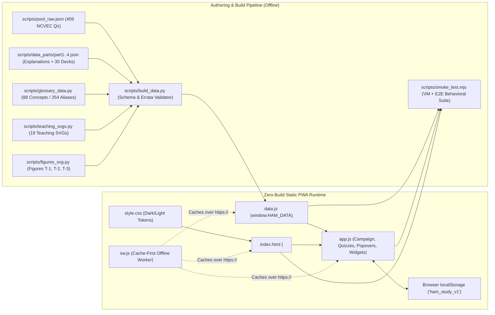

# Architecture — Watt a Ham

System design, data schemas, invariants, and subsystem reference for **Watt a Ham**.

---

## 1. System Overview

Watt a Ham separates **offline authoring/validation** (`scripts/` → `data.js`) from a **zero-build static runtime** (`index.html`, `style.css`, `data.js`, `app.js`, `sw.js`, `manifest.json`, `icon.svg`) that runs identically over HTTPS (GitHub Pages PWA) and `file://` (local disk).

---

## 2. Data Model & Client Storage

### 2.1 `window.HAM_DATA` Bundle ([`../data.js`](../data.js))
Generated by [`../scripts/build_data.py`](../scripts/build_data.py). Top-level keys:

| Key | Shape & Validation Rules |
| :--- | :--- |
| `meta` | `{ element: 2, licenseClass: "Technician", poolCycle: "2026-2030", effective, errataDate: "2026-02-19", totalQuestions: 409, totalGroups: 35 }` |
| `subelements` | Array of 10 descriptors (`T1`–`T0`) with `id`, `title`, and official `examQuestions` weights summing to `35`. |
| `campaign` | Ordered 12-chapter guided learning path (`35` groups total, starting with intuitive `T2`, `T4`, `T0` and interleaving `T1` rules) + 4 `bossAfter` checkpoints (`boss_1`..`boss_4`). |
| `glossary` | Dictionary of `88` keyed concepts: `{ term, expansion, aliases: string[], category, definition, analogy, photo?: string }`. |
| `photos` | Dictionary of `32` bundled equipment photos (`./assets/photos/<slug>.jpg`): `{ src, width, height, title, caption, credit, license, sourceUrl }`. |
| `illustrations` | Dictionary of `19` theme-aware inline `<svg class="teaching-svg">` strings keyed by slug (e.g., `"station-hookup"`, `"repeater-vs-simplex"`). |
| `figures` | Dictionary of official NCVEC schematics `"T-1"`, `"T-2"`, `"T-3"` (`<svg class="schematic-svg">`). |
| `briefings` | Dictionary of `35` group decks (`T1A`–`T0C`). Each has `{ title, subtitle, aid, cards: Card[] }` with `4..7` cards: `3..6` `"concept"` cards (`paragraphs: string[]`, optional `illustration`, optional `widget`) followed by `1` final `"cheatsheet"` card (`bullets: string[]`). |
| `pool` | Array of `409` question objects: `{ id, element, subelement, group, question, choices[4], answer (0..3), has_positional_choice, fcc_rules, figure, tags, explanation }`. |

### 2.2 Persistent User State (`localStorage["ham_study_v1"]`)
Managed in [`../app.js`](../app.js) with graceful fallback to in-memory defaults if `localStorage` is restricted:

- `version`: `1`
- `theme`: `"dark" | "light"` (applied to `<html data-theme="...">`)
- `sound`: `boolean` (synthesized Web Audio API tones—zero audio files)
- `streak`: `{ count, longest, lastDay, activeDay, todayNodes, todayReviewDone, todaySeconds }`
  - Uses a **03:00 AM local rollover** (`getStudyDayKey()`) so studying past midnight still counts toward the same session day.
- `nodes[group]`: `{ status: "locked" | "next" | "in_progress" | "gold", cracked: boolean, clears: number, lastReviewed: number }`
- `bosses`: `{ [bossId]: boolean }` (`74%+` required to clear)
- `questions[id]`: `{ bucket: 0 | 1 | 2 | 3, streak: number, missed: number, hesitated: boolean, lastSeen: number }` (`HESITATION_MS = 12000`)
- `exams`: Up to 30 most recent exam records `{ id, ts, mode: "mock35" | "checkpoint", score, total, studiedScore, studiedTotal, missedIds }`
- `checklist`: `{ frn, session, id_calc, fee35 }`

### 2.3 Portable `HAM1:` Backup / Restore String
`exportBackupString()` serializes a compact dictionary (`v`, `t`, `snd`, `st`, `b`, `cl`, non-default `n` nodes, non-zero `q` question tuples, and `ex` history) via UTF-8-safe Base64 prefixed with `HAM1:`. `importBackupString()` validates and merges into `createDefaultState()` so malformed strings never corrupt app state.

---

## 3. Security, Accessibility & Anti-Spoiler Controls

- **XSS-Safe Rich Text Formatting (`escHtml` + `formatRichText`):** Every dynamic string passes through `escHtml()` *before* controlled inline replacements for `` `code` ``, `**bold**`, `*italic*`, and `<button type="button" class="jargon-term">` tokens.
- **Zero External Network Calls or Secrets:** No analytics, fonts, CDNs, cookies, or API keys exist anywhere in the project.
- **HTML Top-Layer Modals & Popovers:**
  - Modals (`#node-dialog`, `#figure-dialog`, `#confirm-dialog`, `#cards-peek-dialog`) use native `<dialog closedby="any">` (`showModal()`) plus a pointer light-dismiss fallback for browsers lacking `HTMLDialogElement.prototype.closedBy`.
  - `#jargon-popover` uses native `popover="auto"` (`showPopover()`) with a `.is-fallback-open` class fallback. Invoking `showPopover()` while `#cards-peek-dialog` is open promotes `#jargon-popover` above the modal dialog in the browser's top layer natively.
  - Background content `#app-shell` receives the `inert` attribute whenever `#session-overlay` is open.
- **Strict Anti-Spoiler & Valid HTML Boundaries:**
  - `linkJargon` is **enabled** only in Walkthrough Cards, Stage 2 `Flash-Pass` stems, Post-Answer Feedback (`p.feedback-why`), Mistake Walkthroughs, and the Aids Glossary.
  - `linkJargon` is **disabled** on unanswered Stage 3 `Challenge`/Drill stems, inside all `<button class="choice-btn">` elements (preventing invalid nested `<button>` HTML), and throughout `Mock` and `Checkpoint` Exams.
  - `shouldHideSchematicLegend()` strips component-name callouts when zooming Figures `T-1`, `T-2`, or `T-3` before a quiz question is answered or during an unsubmitted Practice Exam.

---

## 4. Key Subsystems & Source Ownership

- **Positional-Safe Choice Shuffler (`buildShuffledChoices` in [`../app.js`](../app.js)):** Standard questions Fisher-Yates shuffle all 4 slots; `"All/None of these choices"` (`58` pool questions) stay pinned to slot `D` while slots `A`–`C` shuffle; explicit letter references (`"Both A and B"`) keep fixed `A`–`D` order.
- **Group-Weighted Readiness & Signal Check (`computeGroupMastery`, `buildSignalCheckQueue` in [`../app.js`](../app.js)):** Weights each of the 35 groups equally (`1/35` each, matching VEC exam sampling) and applies a `0.8×` penalty to `cracked` Gold nodes until repaired via Node Challenge or Signal Check.
- **Jargon Matcher & Nested History (`initGlossaryMatcher`, `openJargonPopover` in [`../app.js`](../app.js)):** Pre-compiles all 254 aliases sorted longest-first into a single boundary-aware regex (`JARGON_RE`), linking only the first occurrence per concept per card/view and maintaining `jargonHistory` for `← Back` navigation across nested popover clicks.
- **Interactive Mini-Widgets (`renderMiniAidForBriefing`, `refreshInteractiveWidgetHost` in [`../app.js`](../app.js)):** Stateful inline widgets (`repeater-sim`, `duty-slider`, `switch-flipper`, `wavelength-slider`, `power-circle`, `ohms-circle`, `bandwidth-ladder`, `band-privileges`, `fig-t1`/`t2`/`t3`) re-render in place inside Stage 1 lessons, Read-Only Handbook mode, and `#cards-peek-dialog` while preserving scroll offset.
- **Automated Verification (`scripts/smoke_test.mjs` in [`../scripts/smoke_test.mjs`](../scripts/smoke_test.mjs)):** Validates file budgets, `manifest.json` / `sw.js` parity, all 409 questions + 35 decks + 88 glossary concepts, DOM ID bindings, markdown hygiene, and runs a full simulated user journey inside a `node:vm` sandbox (Tabs → Glossary search → Read-Only locked node + Jargon popover + nested `← Back` → T2A Walkthrough + `repeater-sim` + `📖 Cards` peek + Flash-Pass + Challenge loop-back → 35-Q Mock Exam + spoiler check + cracking → Signal Check repair → `HAM1:` backup round-trip).
